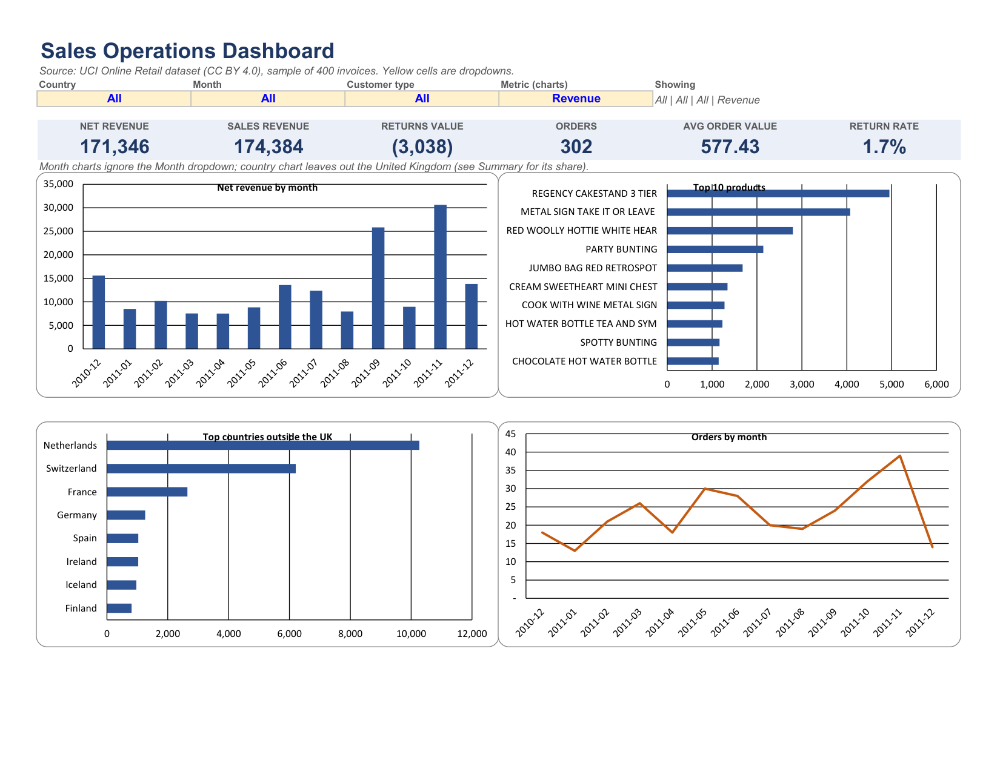
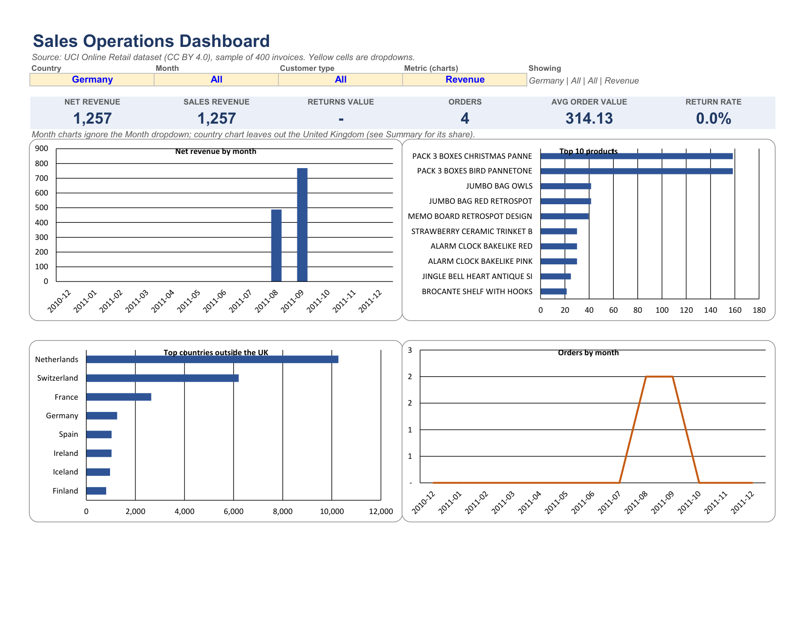

# Excel Sales Dashboard

An Excel operations dashboard built from a messy public retail dataset. Raw data goes in, a documented cleaning step runs, and a one-page dashboard with dropdown filters comes out.





## What it is

`excel-sales-dashboard.xlsx` has eight sheets:

| Sheet | Purpose |
|---|---|
| Dashboard | One printable page. Four dropdowns (Country, Month, Customer type, Metric), six KPI cards, four charts. |
| Summary | Unfiltered tables by month, by country and by customer type, plus a country lookup with a dropdown. |
| Clean | The cleaned data as an Excel table (`tblClean`). 8,335 rows. |
| Cleaning Log | Every change made, one row per change (4,545 rows), plus a rule table with counts and a reconciliation check. |
| Raw | The sampled source data, untouched. 8,495 rows. |
| Calc | Helper tables that feed the charts (monthly, top 10 products, top countries outside the UK). |
| Lists | The values behind the dropdowns. |
| Modern Functions | `XLOOKUP`, `UNIQUE`, `SORT`, `FILTER`, `SORTBY`, `TAKE`. Needs Excel 365 or 2021+. |

## Data source and licence

- Dataset: **Online Retail**, UCI Machine Learning Repository. https://archive.ics.uci.edu/dataset/352/online+retail
- DOI: 10.24432/C5BW33
- Licence: **CC BY 4.0**. Credit: Chen, D. (2015), Online Retail, UCI Machine Learning Repository.
- Content: transactions of a UK online gift shop, 2010-12-01 to 2011-12-09.
- Sample used: 400 whole invoices picked with random seed 42 (`scripts/prepare_data.py`), which gives 8,495 rows. Whole invoices are kept so that orders stay complete. The sample is a small slice, so totals here are not the shop's real totals.

## How the cleaning works

Nine rules, each logged. Counts come from the Cleaning Log sheet.

| Rule | What | Rows |
|---|---|---|
| R01 | Remove exact duplicate rows | 69 |
| R02 | Remove non-product lines (postage, bank charges, fees, and similar service codes) | 51 |
| R03 | Remove stock adjustments (Quantity <= 0 on an invoice that is not a return) | 27 |
| R04 | Remove rows with UnitPrice <= 0 | 13 |
| R05 | Trim spaces in Description | 1,994 |
| R06 | Use the most common Description spelling per StockCode | 85 |
| R07 | Rename country (EIRE to Ireland) | 65 |
| R08 | Blank CustomerID becomes GUEST | 2,241 |
| R09 | Blank Description becomes UNKNOWN | 0 |

Raw 8,495 minus 160 removed (R01 to R04) equals Clean 8,335. The Cleaning Log sheet checks this and shows OK.

Return invoices (InvoiceNo starts with C) are kept and labelled `Type = Return`. They count against net revenue.

## Live formulas and pre-computed parts

Live (recalculate when you change a dropdown or a Clean row):
- Clean columns J to N: Type, Revenue, Month, CustType, OrderFlag.
- Every KPI card on the Dashboard (`SUMIFS` over named ranges; the choice "All" becomes the wildcard `*`).
- Summary tables, the Summary country lookup (`INDEX`/`MATCH`), the Calc helper tables and their top-N rankings (`LARGE` + `INDEX`/`MATCH`), the Cleaning Log counts.
- Modern Functions sheet (`XLOOKUP`, `UNIQUE`, `SORT`, `FILTER`).

Pre-computed by Python (does not change when you edit data):
- The cleaning itself. Clean columns A to I are static values written by `scripts/build_workbook.py`. Column I (`RawRow`) is the row number in the Raw sheet.
- The Cleaning Log rows.
- Which products, countries and months exist in the lists, and the row order of the Summary country table (sorted by net revenue when the file was built). The numbers next to them are live, the order is not.

## Power Query steps (plain text)

The Python script does the cleaning for this file. In Excel the same steps can be done in Power Query. These steps are written from the cleaning rules above. I did not build or run a Power Query version.

1. Data tab, Get Data, From Text/CSV, pick `data/raw_sample.csv`, Transform Data.
2. Set types: Quantity whole number, UnitPrice decimal, InvoiceDate date/time, CustomerID text.
3. Home, Remove Rows, Remove Duplicates over all columns (R01).
4. Filter StockCode to drop the service codes listed in R02.
5. Filter out rows where Quantity <= 0 and InvoiceNo does not start with C (R03).
6. Filter UnitPrice greater than 0 (R04).
7. Transform, Format, Trim on Description (R05).
8. Replace Values in Country: EIRE with Ireland (R07).
9. Replace null in CustomerID with GUEST (R08); replace null in Description with UNKNOWN (R09).
10. Add Column, Conditional Column: Type = Return if InvoiceNo starts with C, otherwise Sale.
11. Add Column, Custom Column: Revenue = Quantity * UnitPrice.
12. Close and Load to a table.

R06 (most common spelling per StockCode) needs a Group By on StockCode and Description, then a merge. It is the hardest step to do in Power Query.

## How AI helped

An AI coding assistant wrote the Python scripts and the first drafts of these documents. It also drove desktop Excel through its automation interface to add the dynamic-array formulas, recalculate and export the screenshots. I directed the work and checked the numbers (see Verification).

## What broke and how it was fixed

- First screenshots were blank. Excel's copy-as-picture does not work when Excel is hidden. Fixed by exporting the Dashboard sheet to PDF and rendering that to PNG.
- Charts overlapped on the dashboard because row heights were not fixed. Fixed by setting rows 11 to 42 to 15 pt and making the charts 7.4 cm tall.
- Bar charts showed their value axis at the top after the category order was reversed. Fixed by making the value axis cross at the maximum.
- The orders line chart curved below zero because of line smoothing. Fixed by switching smoothing off.
- The Modern Functions sheet landed first in the workbook because the `After=` argument is ignored through COM. Fixed with `Move`.
- The LibreOffice recalculation script failed on Windows (`module 'socket' has no attribute 'AF_UNIX'`). Not fixed. The dynamic-array formulas are built only in real Excel, so a LibreOffice check was not done.

## Verification

Run on the final file with desktop Excel 365:
- Error scan of every used cell on every sheet for `#REF!`, `#N/A`, `#VALUE!`, `#DIV/0!`, `#NAME?`, `#NUM!`, `#NULL!`: **none found**. The scan ran with the dropdowns on All and again after switching to Germany.
- Dashboard KPIs match an independent pandas calculation on the Clean data: net revenue 171,346.13, 302 orders, Germany net revenue 1,256.50 with 4 orders.
- Cleaning Log reconciliation shows OK.

Not verified: LibreOffice, Excel for Mac, Excel for the web, older Excel versions, the Power Query steps, and the dropdowns used by hand with the keyboard. The filter tests set the dropdown cells through automation.

## How to run

Open `excel-sales-dashboard.xlsx` in Excel 365 or 2021+. Go to the Dashboard sheet, select a yellow cell and press Alt+Down to open its list.

To rebuild from source (Windows, desktop Excel installed):

```
pip install pandas openpyxl pywin32 pymupdf
python scripts/prepare_data.py "path/to/Online Retail.xlsx"
python scripts/build_workbook.py _work/stage1.xlsx
python scripts/finish_in_excel.py _work/stage1.xlsx excel-sales-dashboard.xlsx screenshots
```

Download `Online Retail.xlsx` from the UCI page above first. `prepare_data.py` writes `data/raw_sample.csv`, which `build_workbook.py` reads.

## Limits

- Sample of 400 invoices, not the full dataset. About 84% of net revenue is from the United Kingdom, and some countries have one order, so country rankings are noisy.
- Dates run from 2010-12 to 2011-12. December 2011 is a partial month.
- The Month dropdown changes the KPI cards, the top 10 products and the top countries. The two monthly charts always show every month. They do respond to Country and Customer type.
- The Metric dropdown (Revenue or Units) changes the top products and top countries charts only.
- The Summary sheet ignores the dropdowns.
- Older Excel (2019 and earlier) shows `#NAME?` on the Modern Functions sheet. Nothing else uses those functions.
- Customer type is Registered or Guest, based on a blank CustomerID. It is not a customer segment.

## Files

See [WALKTHROUGH.md](WALKTHROUGH.md) for each file in plain English, [KEYBOARD.md](KEYBOARD.md) for keyboard use, and [PRACTICE.md](PRACTICE.md) for ten tasks to redo from the Raw sheet.

## Licence

Code: MIT, see [LICENSE](LICENSE). Data: CC BY 4.0, see above.
