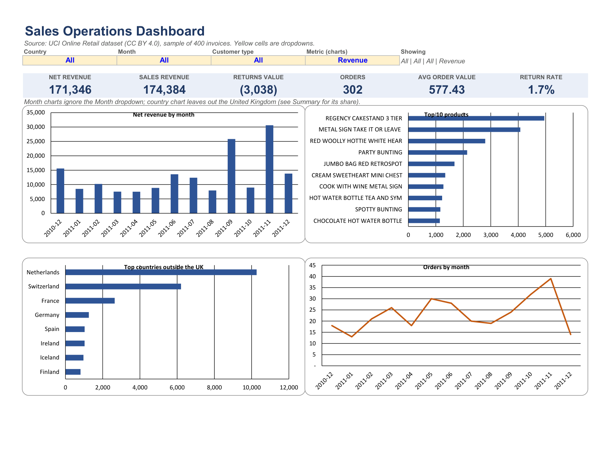
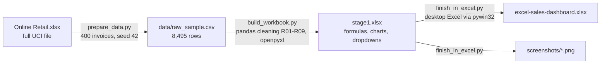
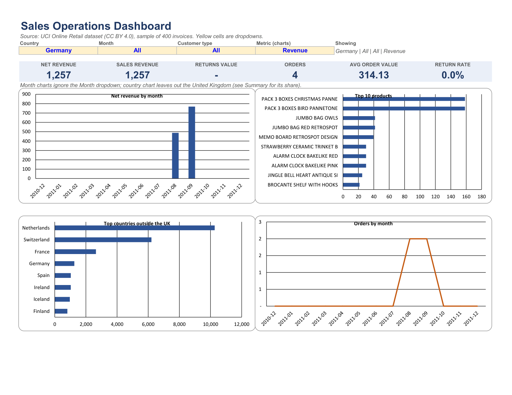

# Excel Sales Dashboard

An Excel workbook that cleans a messy public retail dataset and shows the result on one dashboard page with dropdown filters.

I built it as a portfolio project to practise data cleaning and dashboards in Excel. Every cleaning step is logged in the workbook, so each number on the dashboard can be traced back to the raw rows.



## Quick start

Open `excel-sales-dashboard.xlsx` in Excel 365 or 2021+. Go to the Dashboard sheet, select a yellow cell and press Alt+Down to open its list.

To rebuild the file from source (Windows, desktop Excel installed). Download `Online Retail.xlsx` from the UCI page below first.

```
pip install -r requirements.txt
python scripts/prepare_data.py "path/to/Online Retail.xlsx"
python scripts/build_workbook.py _work/stage1.xlsx
python scripts/finish_in_excel.py _work/stage1.xlsx excel-sales-dashboard.xlsx screenshots
```

## How the data flows



The second stage exists because openpyxl cannot write dynamic-array formulas in a way Excel treats as spilling. Desktop Excel can, so a short script drives it.

Filtering on the dashboard follows a chain: a dropdown cell feeds a criteria cell on the Calc sheet (All becomes the wildcard `*`), `SUMIFS` formulas read the criteria, and the charts read the Calc tables.

## Germany filter

This is the same page with Country set to Germany.



## What is in the workbook

| Sheet | Purpose |
|---|---|
| Dashboard | One printable page. Four dropdowns (Country, Month, Customer type, Metric), six KPI cards, four charts. |
| Summary | Unfiltered tables by month, country and customer type, plus a country lookup with a dropdown. |
| Clean | The cleaned data as an Excel table (`tblClean`). 8,335 rows. |
| Cleaning Log | One row per change (4,545 rows), a rule table with counts, and a reconciliation check. |
| Raw | The sampled source data, untouched. 8,495 rows. |
| Calc | Helper tables that feed the charts: monthly, top 10 products, top countries outside the UK. |
| Lists | The values behind the dropdowns. |
| Modern Functions | `XLOOKUP`, `UNIQUE`, `SORT`, `FILTER`, `SORTBY`, `TAKE`. Needs Excel 365 or 2021+. |

## Data source and licence

- Dataset: Online Retail, UCI Machine Learning Repository. https://archive.ics.uci.edu/dataset/352/online+retail
- DOI: 10.24432/C5BW33
- Licence: CC BY 4.0. Credit: Chen, D. (2015), Online Retail, UCI Machine Learning Repository.
- Content: transactions of a UK online gift shop, 2010-12-01 to 2011-12-09.
- Sample used: 400 whole invoices picked with random seed 42 (`scripts/prepare_data.py`), which gives 8,495 rows. I kept whole invoices so orders stay complete. This is a small slice, so the totals are not the shop's real totals.

## How the cleaning works

There are nine rules and each one is logged. The counts come from the Cleaning Log sheet.

| Rule | What | Rows |
|---|---|---|
| R01 | Remove exact duplicate rows | 69 |
| R02 | Remove non-product lines (postage, bank charges, fees and similar service codes) | 51 |
| R03 | Remove stock adjustments (Quantity <= 0 on an invoice that is not a return) | 27 |
| R04 | Remove rows with UnitPrice <= 0 | 13 |
| R05 | Trim spaces in Description | 1,994 |
| R06 | Use the most common Description spelling per StockCode | 85 |
| R07 | Rename country (EIRE to Ireland) | 65 |
| R08 | Blank CustomerID becomes GUEST | 2,241 |
| R09 | Blank Description becomes UNKNOWN | 0 |

Raw has 8,495 rows. Minus the 160 removed by R01 to R04, that leaves the 8,335 in Clean. The Cleaning Log sheet checks this and shows OK.

Return invoices (InvoiceNo starts with C) stay in the data with `Type = Return`. They count against net revenue.

## Live formulas and pre-computed parts

Live, so they recalculate when you change a dropdown or a Clean row:
- Clean columns J to N: Type, Revenue, Month, CustType, OrderFlag.
- Every KPI card on the Dashboard. These are `SUMIFS` over named ranges.
- The Summary tables and country lookup (`INDEX`/`MATCH`), the Calc helper tables with their top-N rankings (`LARGE` + `INDEX`/`MATCH`), and the Cleaning Log counts.
- The Modern Functions sheet.

Pre-computed by Python, so they do not change when you edit data:
- The cleaning itself. Clean columns A to I are static values written by `scripts/build_workbook.py`. Column I (`RawRow`) is the row number in the Raw sheet.
- The Cleaning Log rows.
- Which products, countries and months appear in the lists, and the row order of the Summary country table, which was sorted by net revenue when the file was built. The numbers next to them are live. The order is not.

## Power Query steps (plain text)

The Python script does the cleaning in this file. The same steps can be done in Power Query. I wrote these steps from the cleaning rules above and I did not build or run a Power Query version.

1. Data tab, Get Data, From Text/CSV, pick `data/raw_sample.csv`, Transform Data.
2. Set types: Quantity whole number, UnitPrice decimal, InvoiceDate date/time, CustomerID text.
3. Home, Remove Rows, Remove Duplicates over all columns (R01).
4. Filter StockCode to drop the service codes listed in R02.
5. Filter out rows where Quantity <= 0 and InvoiceNo does not start with C (R03).
6. Filter UnitPrice greater than 0 (R04).
7. Transform, Format, Trim on Description (R05).
8. Replace Values in Country: EIRE with Ireland (R07).
9. Replace null in CustomerID with GUEST (R08), and null in Description with UNKNOWN (R09).
10. Add Column, Conditional Column: Type = Return if InvoiceNo starts with C, otherwise Sale.
11. Add Column, Custom Column: Revenue = Quantity * UnitPrice.
12. Close and Load to a table.

R06 (most common spelling per StockCode) needs a Group By on StockCode and Description, then a merge. It is the hardest step to do in Power Query.

## How AI helped

An AI coding assistant wrote the Python scripts and the first drafts of these documents. It also drove desktop Excel through its automation interface to add the dynamic-array formulas, recalculate and export the screenshots. I directed the work and checked the numbers (see Verification).

## What broke and how I fixed it

- The first screenshots were blank. Excel's copy-as-picture does not work while Excel is hidden. I now export the Dashboard sheet to PDF and render that to PNG.
- Charts overlapped because the row heights were not fixed. Rows 11 to 42 are now 15 pt and the charts are 7.4 cm tall.
- The bar charts showed their value axis at the top once I reversed the category order. The value axis now crosses at the maximum.
- The orders line chart curved below zero because of line smoothing. Smoothing is off.
- The Modern Functions sheet landed first in the workbook because the `After=` argument is ignored through COM. `Move` fixes it.
- The LibreOffice recalculation script failed on Windows (`module 'socket' has no attribute 'AF_UNIX'`). I did not fix it. The dynamic-array formulas are built only in real Excel, so I did no LibreOffice check.

## Verification

I ran these on the final file in desktop Excel 365:
- An error scan of every used cell on every sheet for `#REF!`, `#N/A`, `#VALUE!`, `#DIV/0!`, `#NAME?`, `#NUM!` and `#NULL!` found none. The scan ran with the dropdowns on All and again on Germany.
- The Dashboard KPIs match a pandas calculation on the Clean data that I ran by hand. The check script is not in the repo. Net revenue is 171,346.13 with 302 orders. Germany has net revenue of 1,256.50 and 4 orders.
- The Cleaning Log reconciliation shows OK.

Not verified: LibreOffice, Excel for Mac, Excel for the web, older Excel versions, the Power Query steps, and the dropdowns used by hand with the keyboard. My filter tests set the dropdown cells through automation.

## Limits

- It is a sample of 400 invoices, not the full dataset. About 84% of net revenue comes from the United Kingdom and some countries have one order, so the country rankings are noisy.
- Dates run from 2010-12 to 2011-12. December 2011 is a partial month.
- The Month dropdown changes the KPI cards, the top 10 products and the top countries. The two monthly charts always show every month, but they do respond to Country and Customer type.
- The Metric dropdown (Revenue or Units) changes only the top products and top countries charts.
- The Summary sheet ignores the dropdowns.
- Older Excel (2019 and earlier) shows `#NAME?` on the Modern Functions sheet. Nothing else uses those functions.
- Chart polish I saw in the screenshot and did not fix: the chart titles sit on top of the plot area (visible on the two horizontal bar charts), the gridlines are heavy black, and long product names are cut off at 28 characters.
- Customer type is Registered or Guest, taken from whether CustomerID is blank. It is not a customer segment.

## Diagrams

- [Components](docs/diagrams/components.md): scripts, data files and tests.
- [Build flow](docs/diagrams/build-flow.md): call order from CSV to finished workbook.
- [Cleaning rules](docs/diagrams/cleaning-rules.md): order of R01 to R09.
- [Dashboard filter chain](docs/diagrams/dashboard-filter.md): dropdown to Calc to charts.
- [Workbook sheets](docs/diagrams/workbook-sheets.md): how the sheets relate.

## Files

[WALKTHROUGH.md](WALKTHROUGH.md) explains each file, [KEYBOARD.md](KEYBOARD.md) covers keyboard use, and [PRACTICE.md](PRACTICE.md) has ten tasks to redo from the Raw sheet.

## Licence

Code: MIT, see [LICENSE](LICENSE). Data: CC BY 4.0, see above.
