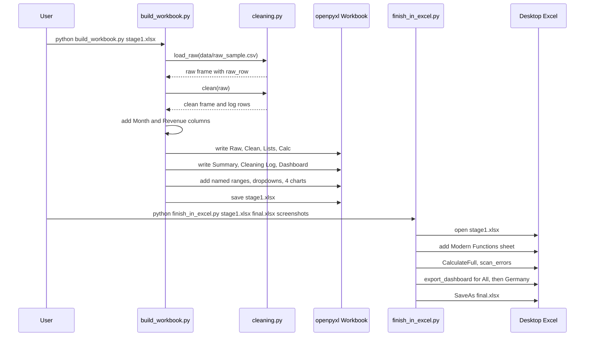

# Build flow

Order of calls from the raw CSV to the finished workbook.

Sources: [build_workbook.py](../../scripts/build_workbook.py), [cleaning.py](../../scripts/cleaning.py), [finish_in_excel.py](../../scripts/finish_in_excel.py)

