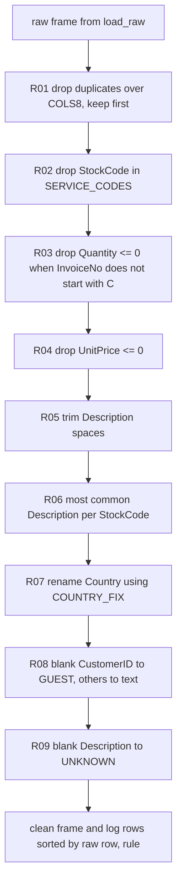

# Cleaning rules

Order in which `clean()` applies R01 to R09 to the raw frame.

Sources: [cleaning.py](../../scripts/cleaning.py), [test_cleaning.py](../../tests/test_cleaning.py)

Every rule writes its changes to the log through the `add_log` helper. R01 to R04 log one `row removed` entry per dropped row.
