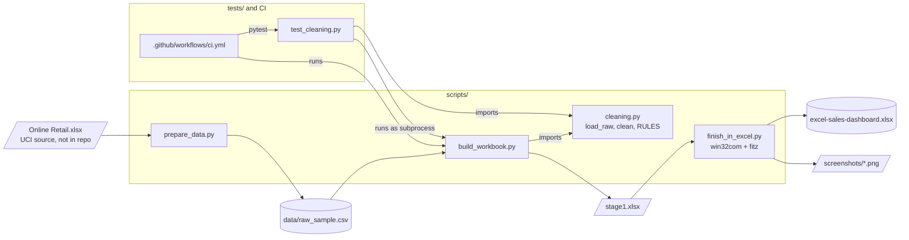

# Components

Scripts, data files and workbook sheets, and how they connect.

Sources: [prepare_data.py](../../scripts/prepare_data.py), [cleaning.py](../../scripts/cleaning.py), [build_workbook.py](../../scripts/build_workbook.py), [finish_in_excel.py](../../scripts/finish_in_excel.py), [test_cleaning.py](../../tests/test_cleaning.py), [ci.yml](../../.github/workflows/ci.yml)

