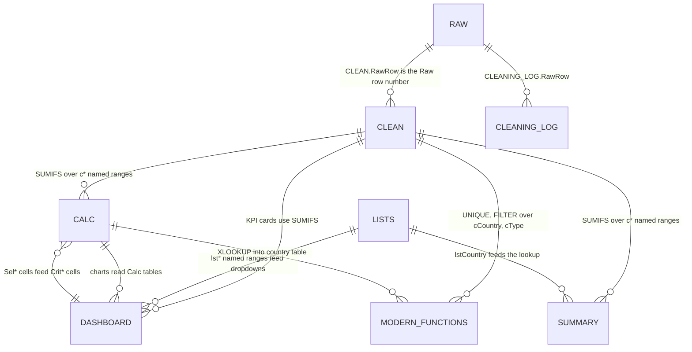

# Workbook sheets

How the sheets relate. Links are by named range or by a column value.

Sources: [build_workbook.py](../../scripts/build_workbook.py), [finish_in_excel.py](../../scripts/finish_in_excel.py), [excel-sales-dashboard.xlsx](../../excel-sales-dashboard.xlsx)

